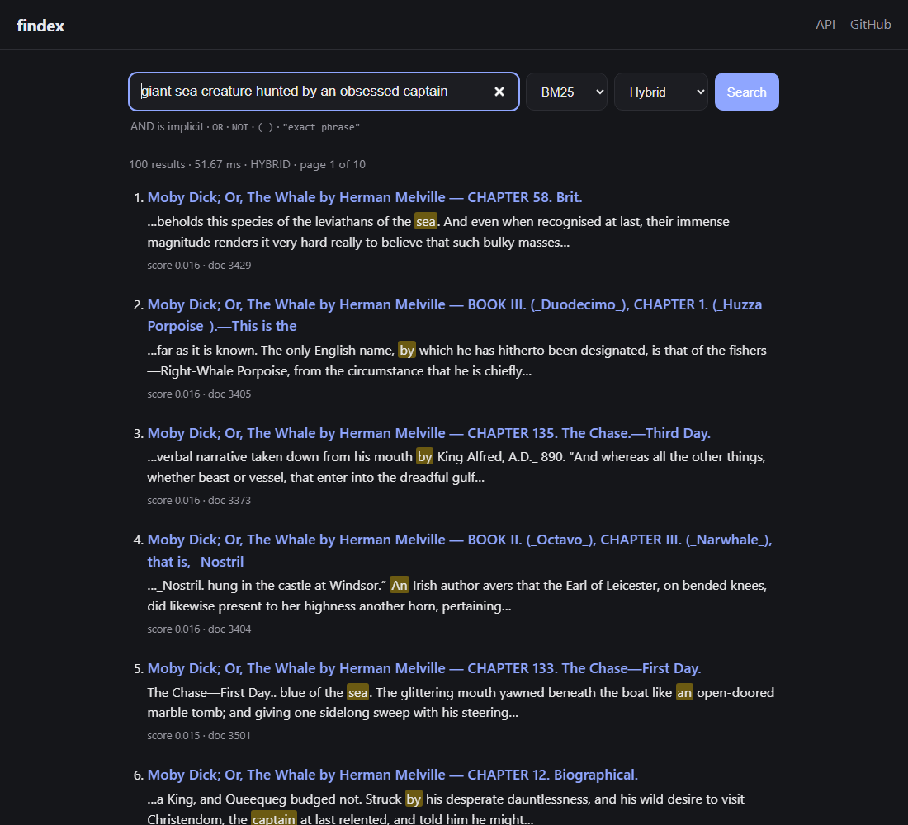
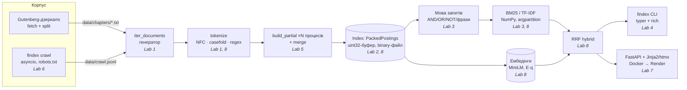
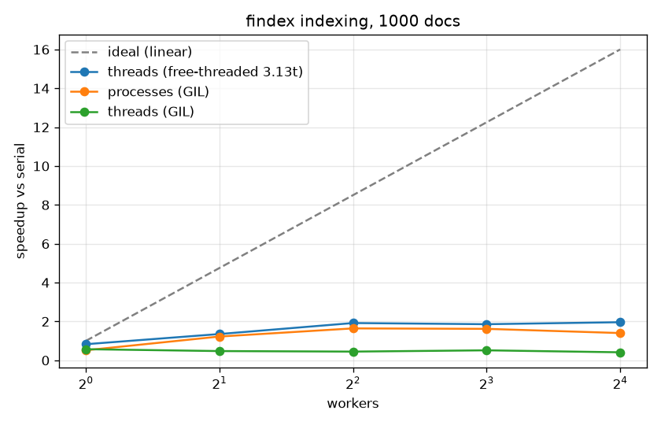

# findex — власна пошукова система

[](https://github.com/kurcher/PythonLabsRepo/actions/workflows/ci.yml)

**Повнотекстовий + семантичний пошук по 107 книжках Project Gutenberg (5 229 розділів, 113 МБ):
інвертований індекс, BM25, мова запитів, асинхронний краулер, CLI, FastAPI-сайт і гібридний пошук
на ембедінгах. Усе написано з нуля впродовж 8 лабораторних** курсу
[Python — Build a Search Engine](https://github.com/rmalkevy/Programming-Practice-Projects/tree/main/courses/python).
Кожна лаба позначена git-тегом `lab-01` … `lab-08`; фінальна версія — `v1.0.0`.

* **Live demo:** _ще не задеплоєно_. Деплой займає ~5 хв з власного акаунта Render, інструкція в розділі
  [«Як зробити сайт публічним»](#як-зробити-сайт-публічним-деплой). Отриману адресу вставити сюди.
* **Демо-відео (2–3 хв):** _посилання додати після запису_.



| | |
|---|---|
| **Корпус** | 5 229 документів · 17,5 млн токенів · словник 246 809 · індекс 45 МіБ (112 МіБ з позиціями) |
| **Латентність** | `/search` при 50 одночасних клієнтах, 4 воркери: **p95 378 мс, 180 RPS** (було 2 124 мс / 41 RPS до Lab 8) |
| **Найбільші прискорення** | завантаження індексу **32×** (12.3 → 0.38 с) · NumPy-скорер **30×** · сніпети **4.9×** · пропускна здатність сервісу **4.4×** |
| **Якість** | precision@5 на 15 запитах: keyword 0.52 → **semantic 0.81 / hybrid 0.79**; на перефразованих запитах 0.00 → 0.60 |
| **Інженерія** | pyright strict 0 помилок · 132 тести (з них 9 Hypothesis-властивостей) · CI · wheel-реліз · Docker (non-root, 220 МБ) |

### Швидкий старт

```bash
uv sync                                               # Python 3.13, залежності
uv run python scripts/fetch_gutenberg.py && uv run python scripts/split_chapters.py   # корпус → data/chapters/
uv run findex index data/chapters --out build/index.bin --positions                     # паралельно, ~40 с
uv run findex search build/index.bin '"white whale" NOT ship'                          # CLI
uv run findex serve --index build/index.bin                                            # сайт: http://127.0.0.1:8000/
uv sync --extra semantic && uv run findex embed build/index.bin --max-chunks 6         # семантичний пошук (опційно)
```

## Архітектура



## Усі вимірювання в одному місці

| Лаба | Що міряли | Результат |
|---|---|---|
| [1](#lab-1--потоки-а-не-списки) | пікова пам'ять, весь корпус | генератори **43 МіБ** проти списків **1 200 МіБ** |
| [2](#lab-2--інвертований-індекс) | пам'ять постингів (5 млн) | plain dataclass 541 → `slots` 351 → `array('I')` **129 МіБ** |
| [2](#lab-2--інвертований-індекс) | формати файлу | binary 44.7 МіБ / save 2.8 с проти pickle 80 МіБ / 29.6 с |
| [2](#lab-2--інвертований-індекс) | merge vs set | set швидший на двох довгих списках (160 vs 756 мкс); merge — на асиметричних (0.5 vs 86 мкс) |
| [3](#lab-3--ранжування-та-обєктна-модель) | precision@5, 10 запитів | TF-IDF 0.76, BM25 0.78 |
| [4](#lab-4--справжній-інструмент-типи-тести-пакет-cli) | тести / покриття | 61 тест, 6 Hypothesis-властивостей, 87 % (зараз 132 тести) |
| [5](#lab-5--конкурентність-і-gil) | індексація 1 000 док., 4 воркери | потоки під GIL **0.45×**, процеси **1.64×**, free-threaded потоки **1.92×** |
| [5](#lab-5--конкурентність-і-gil) | I/O, 40 сторінок | потоки під GIL **3×** |
| [6](#lab-6--асинхронний-краулер) | краулер, 200 сторінок | concurrency 1 → 20: **4.4 → 13.1** стор./с (одним потоком) |
| [7](#lab-7--пошук-у-вебі-fastapi-pydantic-docker) | `def` vs `async def` під навантаженням | `/health` 1.8 с vs 3.1 с (цикл вільний лише з `def`) |
| [7](#lab-7--пошук-у-вебі-fastapi-pydantic-docker) | `oha`, 50 клієнтів | 1 воркер 10–12 RPS → 4 воркери 41 RPS |
| [8](#lab-8--спершу-швидко-потім-розумно) | гарячі точки | сніпети **4.9×**, load **32×**, індексація **1.4–1.6×** |
| [8](#lab-8--спершу-швидко-потім-розумно) | NumPy-скорер | частий терм **30×**, рідкісний 1.8× |
| [8](#lab-8--спершу-швидко-потім-розумно) | `oha` після оптимізацій | 4 воркери **180 RPS, p99 408 мс** (було 41 RPS, 2 311 мс) |
| [8](#lab-8--спершу-швидко-потім-розумно) | precision@5, 15 запитів | keyword 0.52 · semantic **0.81** · hybrid 0.79 |

## Корпус

**Project Gutenberg, "Top 100"**: 107 найпопулярніших книжок (англійська переважно, плюс кілька
іспанських/португальських/французьких), порізаних на розділи → **5 229 документів, 113 МБ тексту,
17,5 млн токенів, словник 246 809 термів**.

Корпус у git не потрапляє (`data/` у `.gitignore`). Як відтворити:

```bash
uv run python scripts/fetch_gutenberg.py      # ~107 книжок у data/gutenberg/ (з дзеркала PG, 1 запит/с)
uv run python scripts/split_chapters.py       # data/chapters/<книга>/<NNN>.txt — один розділ = один документ
```

`fetch_gutenberg.py` бере список з `gutenberg.org/browse/scores/top` (один запит), а самі тексти —
з офіційного дзеркала (PG просить роботів не качати з головного сайту), прибирає ліцензійний
заголовок/футер PG. `split_chapters.py` ріже книжку по заголовках `CHAPTER/BOOK/PART/STAVE/LETTER …`,
а якщо їх < 5 — на шматки ~20 КБ по межах абзаців. Перший рядок файлу — `<назва книги> — <розділ>`.

---

## Lab 1 — потоки, а не списки

```bash
uv run python -m findex.stats data/chapters            # статистика всього корпусу
uv run python -m findex.stats data/chapters --limit 500 --eager
uv run pytest
```

* `findex.corpus.iter_documents(root)` — генератор `Document(doc_id, path, text)`. Відкриває один файл
  за раз (`rglob("*")`, сортовано, тож `doc_id` стабільні). Підтримує дерево `*.txt`, JSON-lines
  (`*.jsonl`, поле `text`, опційно `title`) і те саме в `gzip` без розпакування. Файл з неправильним
  кодуванням логується (`logging.warning`) і пропускається. `next(iter_documents(Path("data/chapters")))`
  повертається за ~40 мс — читається лише перший файл.
* `findex.tokenize.tokenize(text)` — генератор поверх `re.finditer`.
* `findex.stats` — один прохід: `Counter.update(tokenize(doc.text))` на кожен документ;
  `--limit N` через `itertools.islice`; час — `perf_counter`, пікова пам'ять — `tracemalloc`.

### Правила токенізатора

| Правило | Приклад |
|---|---|
| NFC, потім `casefold()` | `"Straße"` → `strasse`; `"cafe" + U+0301` (e + комбінований акут) == `"café"` |
| Слово = літери та цифри Unicode (`\w` без `_`); решта — роздільники | `snake_case` → `snake`, `case` |
| Комбіновані знаки, що лишились після NFC (наголос у кирилиці), видаляються | `за́мок` → `замок` |
| Апостроф `'` `’` `ʼ` **всередині** слова зберігається й уніфікується до `'`; на краях — це лапки, відкидаються | `don’t` → `don't`, `пʼять` → `п'ять`, `'quoted'` → `quoted` |
| Дефіс розділяє | `well-known` → `well`, `known` (запит токенізується так само, тож збіг є) |
| Цифри — токени; змішані літери+цифри — один токен | `1984`, `mp3`; `3.14` → `3`, `14` |

Тести: `tests/test_tokenize.py` (10 перевірок: регістр, `ß`, кирилиця, NFC з комбінованим знаком,
наголос, пунктуація, апострофи, дефіси, цифри, порожній рядок, і що `tokenize` — генераторна функція).

### Результат на повному корпусі

`python -m findex.stats data/chapters` → 5 229 документів, 17 511 543 токени, словник 246 809,
топ-3: `the` 839 787, `and` 535 892, `of` 492 844. Пікова пам'ять **43 МіБ** при 113 МБ корпусу.

### Eager vs lazy

Обидві версії — `python -m findex.stats data/chapters [--limit N] [--eager]` на одному й тому самому
корпусі (Windows 11, i5-12500H, 16 ГБ RAM, CPython 3.13.7; час — під увімкненим `tracemalloc`, який
сповільнює програму приблизно вдвічі, тож порівнювати варто відносно).

| Версія | Документів | Токенів | Пікова пам'ять | Час |
|---|---|---|---|---|
| eager (lists) | 500 | 1 639 128 | 111.7 МіБ | 8.8 с |
| lazy (generators) | 500 | 1 639 128 | 7.2 МіБ | 8.8 с |
| eager (lists) | 2 000 | 6 429 853 | 443.9 МіБ | 66.6 с |
| lazy (generators) | 2 000 | 6 429 853 | 11.0 МіБ | 38.9 с |
| eager (lists) | 5 229 (весь корпус) | 17 511 543 | **1 199.8 МіБ** | 159.4 с |
| lazy (generators) | 5 229 (весь корпус) | 17 511 543 | **43.3 МіБ** | 136.5 с |

**Куди пішла пам'ять eager-версії.** Майже вся вона — у токенах як окремих об'єктах `str`.
Кожен токен, який повертає `re.finditer`, — новий рядок: `sys.getsizeof("the") == 44` байти
(заголовок об'єкта ~41 Б + символи), для кирилиці ще більше (`"привіт"` — 70 Б). 17,5 млн токенів ×
~45 Б ≈ **790 МБ**. Зверху — два шари вказівників по 8 Б на токен: `list[list[str]]` по документах
і плаский список `flat` ≈ 2 × 140 МБ, плюс сам текст усіх документів у `list[Document]` ≈ 113 МБ
(ASCII-рядки в CPython — 1 байт на символ). Разом ≈ 1,2 ГБ, що й показує `tracemalloc`. Пам'ять
росте лінійно з корпусом (112 → 444 → 1 200 МіБ), тобто на 10× більшому корпусі eager-версія просто
не влізе в RAM.

**Чому lazy-версія не нуль.** У кожен момент живі лише: поточний документ (його текст, і копія після
NFC+`casefold`, бо `normalize` повертає новий рядок), один поточний токен і `Counter`. `Counter` і є
основна частина 43 МіБ: 246 809 унікальних ключів-рядків (~50 Б кожен) + об'єкти `int` для лічильників
+ сама хеш-таблиця словника (~таблиця індексів і записів по 24 Б). Він росте з розміром *словника*,
а не корпусу — тому 500 → 5 229 документів дає лише 7 → 43 МіБ (закон Гіпса: словник росте
сублінійно). Токен, щойно порахований `Counter.update`, втрачає останнє посилання й одразу
звільняється, тож ті самі 44 байти перевикористовуються для наступного.

**Чому lazy ще й швидша.** Eager створює ~17 млн об'єктів, які живуть одночасно: аллокатор постійно
просить нову пам'ять у ОС, а циклічний GC періодично обходить мільйони контейнерів у списках. Lazy
працює в «гарячому» кеші й перевикористовує ті самі блоки pymalloc.

---

## Lab 2 — інвертований індекс

```bash
uv run python -m findex.index data/chapters --out build/index.bin [--positions] [--format binary|pickle|json]
uv run python -m findex.search build/index.bin "whale OR leviathan NOT ship" [--engine merge|set]
uv run python scripts/bench_lab02.py memory|formats|engines ...   # усі таблиці нижче
```

* `findex.index.build_index(docs, positions=False)` — один потоковий прохід: для кожного документа
  рахується `Counter` (або `term → [позиції]`), одразу «зливається» у `defaultdict(list)` постингів і
  викидається. `doc_id` зростають, тому списки постингів відсортовані без окремого `sort`.
  Результат: `postings: dict[str, list[Posting]]`, `doc_lengths: dict[int, int]`, `doc_meta: dict[int, DocMeta]`.
* `Posting(doc_id, tf, positions=())` і `DocMeta(doc_id, path, title)` — `@dataclass(frozen=True, slots=True)`,
  тобто хешовані (можна класти в `set`, тест `test_dataclasses_are_hashable_and_frozen`) і без `__dict__`.
* `findex.search` — запит `a b OR c NOT d` обчислюється зліва направо; AND/OR/NOT — двопоказникові
  злиття (`intersect`/`union`/`difference`) по відсортованих `doc_id`; `--engine set` — те саме через `set`.
* `findex.store` — `save`/`load` у трьох форматах. **pickle небезпечний**: `pickle.load` викликає
  довільні callables з файлу (`__reduce__` → `os.system(...)`), тож завантажений з інтернету `.pkl`
  = віддалене виконання коду. Тому за замовчуванням — власний `binary`: JSON-заголовок
  (документи + `term → [offset, count, npos]`) і далі один суцільний `array('I')` з doc_ids, tf і позиціями.
  Його завантаження лише розбирає дані.

Корпус: 5 229 документів, 246 809 термів, **4 979 580 постингів**.

### Пам'ять постингів (головна таблиця)

`tracemalloc`, побудова лише постингів на всьому корпусі, кожен варіант в окремому процесі:

| Представлення постингів | Пікова пам'ять (build) | Живе після build | Файл (pickle) | Завантаження |
|---|---|---|---|---|
| `list[Posting]`, звичайний `@dataclass` | 541 МіБ | 534 МіБ | 107.7 МіБ | 13.4 с |
| `list[Posting]`, `slots=True` | 351 МіБ | 344 МіБ | 79.2 МіБ | 20.9 с |
| `array('I')` пари (doc_ids, tfs), без об'єктів | **129 МіБ** | 115 МіБ | **48.6 МіБ** | **0.8 с** |

**Куди пішли байти.** Спільне для всіх рядків — ~246 тис. ключів-рядків словника + хеш-таблиця
(≈ 30–40 МіБ, як і `Counter` у Lab 1). Решта — постинги, ~5 млн штук:

* **plain dataclass**: кожен `Posting` — об'єкт (16 Б заголовок + 8 Б вказівник на `__dict__` + weakref)
  ≈ 48 Б, плюс власний `__dict__` (~100+ Б на ключі `doc_id/tf/positions` у split-table), плюс 8 Б
  вказівника у списку. ≈ 100 Б на постинг → ~500 МіБ. `int` до 256 кешовані, тож tf майже нічого не коштує.
* **slots**: `__dict__` зникає, атрибути лежать у фіксованих слотах прямо в об'єкті: 16 Б заголовок
  + 3 × 8 Б слотів = 40 Б (+GC-заголовок 16 Б) + 8 Б у списку ≈ 64 Б → ~310 МіБ. Ціна: не можна
  додавати нові атрибути, складніше множинне успадкування.
* **array('I')**: жодних об'єктів на постинг — лише 4 Б doc_id + 4 Б tf у суцільному C-буфері = 8 Б.
  Виграш у ~8× на постинг (64 → 8 Б). pickle масиву — це просто сирі байти, тому файл менший, а
  завантаження — це `memcpy`, а не створення 5 млн об'єктів (звідси 0.8 с проти 13–21 с).
  Чому slots-pickle вантажиться *повільніше* за plain: для slots-об'єктів pickle відновлює стан через
  `__setstate__`/`setattr` по кожному слоту, а для plain — одним `__dict__.update`.

### Формати збереження

Повний індекс (`InvertedIndex` з `list[Posting]`, без tracemalloc):

| Формат | Позиції | Розмір файлу | save | load |
|---|---|---|---|---|
| binary | ні | **44.7 МіБ** | **2.8 с** | **25.3 с** |
| pickle | ні | 80.0 МіБ | 29.6 с | 42.1 с |
| json | ні | 45.9 МіБ | 42.5 с | 32.0 с |
| binary | так | 111.7 МіБ | 7.2 с | 25.4 с |
| pickle | так | 134.9 МіБ | 34.3 с | 47.6 с |
| json | так | 134.8 МіБ | 79.9 с | 35.2 с |

Позиції (`--positions`) збільшують binary-індекс у **2.5×** (44.7 → 111.7 МіБ): на кожне входження
токена — ще 4 Б. Load у всіх форматах домінує одне й те саме — створення ~5 млн об'єктів `Posting`;
binary виграє, бо читає числа з `array` замість розбору тексту (json) чи виклику конструкторів через
pickle-опкоди. (У Lab 8 постинги стануть NumPy-масивами — тоді load буде як у рядку `array` вище.)

### merge vs set

`scripts/bench_lab02.py engines build/index.bin`, найкращий з 5 × 20 повторів. Найчастіші терми
корпусу — `a` і `as` (не `the`: іспанські/португальські книжки його не містять):

| Запит | Збігів | merge | set |
|---|---|---|---|
| `as a` (AND, 2 найчастіші) | 5 034 | 0.96 мс | 0.63 мс |
| `as OR a` | 5 178 | 0.98 мс | 0.67 мс |
| `tillest tubalcain` (2 найрідші) | 1 | 0.007 мс | 0.007 мс |
| `as tillest` (частий + рідкий) | 1 | **0.10 мс** | 0.19 мс |

Сама операція на готових відсортованих списках:

| Списки | merge `intersect` | `set &` (множини вже є) | `sorted(set(a) & set(b))` |
|---|---|---|---|
| 5 038 × 5 174 | 756 мкс | 160 мкс | 430 мкс |
| 5 038 × 1 | 0.5 мкс | 0.2 мкс | 86 мкс |

Обидва — O(n + m), але merge — це цикл інтерпретатора (байткод на кожен крок), а `set &` — цикл
у C, тому на двох довгих списках set швидший у ~2–4×. Зате merge не будує хеш-таблиць: коли один
список короткий, двопоказниковий цикл закінчується, щойно вичерпано короткий список (0.5 мкс),
а set-варіант усе одно хешує всі 5 038 елементів довгого (86 мкс). На рідкісних термах різниці
немає — домінує накладна ціна виклику. Висновок: сортовані списки + merge — правильна структура
для диска й для асиметричних запитів; `set` — коли обидва списки довгі й уже в пам'яті.

---

## Lab 3 — ранжування та об'єктна модель

```bash
uv run python -m findex.search build/index-pos.bin 'white whale' '"call me ishmael"' 'white whale' -k 3 -v
uv run python -m findex.search build/index.bin 'whale NOT ship' --scorer tfidf
uv run python scripts/eval_lab03.py build/index-pos.bin
```

* **`Index(Mapping[str, list[Posting]])`** (`findex/index.py`): `__getitem__` (KeyError для
  невідомого терму), `__len__` (кількість термів), `__iter__`, `__contains__`, `__repr__` →
  `<Index 246,809 terms, 5,229 docs, positions>`; `num_docs`, `avg_doc_length` (`cached_property`),
  `doc_length()`, `df()`, `title()`, `text()`. `Mapping` безкоштовно дає `get/keys/items/values/==`.
  `open_index(path)` — `@contextmanager`; `finally` викликає `index.close()` навіть при винятку
  (тест `test_open_index_releases_on_exception`).
* **`Scorer`** (`findex/scoring.py`) — `typing.Protocol` з `__call__(term, posting, index) -> float`;
  `TfIdf` = `(1 + log tf) · log(N/df)` і `BM25(k1=1.5, b=0.75)` — frozen dataclasses з `__call__`.
  `search(index, query, scorer=BM25(), k=10)` накопичує `score[doc_id]` по постингах позитивних
  термів запиту та бере топ-k через `heapq.nlargest` (O(n log k)). Результат — `SearchResult(score,
  doc_id, title, snippet)` з `order=True`; `score` стоїть першим полем, тож `sorted(results, reverse=True)`
  — це ранжування (`title`/`snippet` мають `compare=False`).
* **Мова запитів** (`findex/query.py`) — рекурсивний спуск: `or_expr → and_expr ('OR' and_expr)*`,
  `and_expr → not_expr ('AND'? not_expr)*`, `not_expr → 'NOT' not_expr | atom`,
  `atom → слово | "фраза" | '(' or_expr ')'`. Вузли `Term/Phrase/And/Or/Not` — frozen dataclasses,
  перевантажують `&`, `|`, `~`, мають `evaluate(index) -> frozenset[int]`. `And(x, Not(y))`
  обчислюється як різниця без матеріалізації «всі документи мінус y». Фрази — через позиції:
  документ підходить, якщо існує `p` з `p+i` у позиціях i-го слова. Тести порівнюють *дерева*:
  `parse("a OR b c") == Or(Term("a"), And(Term("b"), Term("c")))`.
* **`@timed`** (`findex/decorators.py`, з `functools.wraps`, PEP 695 `[**P, R]`) на `build_index`,
  `store.load`, `search` — пише `INFO findex.timing: search took 39.11 ms` у лог (`-v`).
* **`lru_cache(maxsize=256)`** на шляху «рядок запиту → множина doc_id» (`Index.matching`). Він
  пер-інстансний, бо `Index` нехешований (`Mapping` ставить `__hash__ = None`), тож його не можна
  передати в модульну кешовану функцію. Видно в лозі на повторному запиті:
  ```
  DEBUG matching cache: CacheInfo(hits=0, misses=1, ...)   # 'white whale'      — 39.1 ms
  DEBUG matching cache: CacheInfo(hits=0, misses=2, ...)   # '"call me ishmael"'
  DEBUG matching cache: CacheInfo(hits=1, misses=2, ...)   # 'white whale' знов — 28.9 ms
  ```
  (решта часу — скоринг і читання файлів для сніпетів).
* **Сніпети** (`findex/snippets.py`): вікно ~160 символів з найбільшою кількістю *різних* термів
  запиту, межі вирівняні по словах, збіги підсвічені (`**…**`, ANSI у терміналі, `<mark>` для веба в Lab 7).
  Пошук збігів іде по NFC-тексту без casefold, тож регістр оригіналу зберігається:
  ```
  1.  10.334  [3413] Moby Dick; Or, The Whale by Herman Melville — CHAPTER 41. Moby Dick.
       …intervals only, the unaccompanied, secluded **White** **Whale** had haunted those uncivilized seas…
  ```

### Три перевірки ранжування на корпусі

(N = 5 229, середня довжина документа 3 349 токенів.)

1. **Рідкісний терм важить більше.** `harpoon` (df = 39) з tf = 1 дає BM25 **6.55** (TF-IDF 4.90), а
   `the` (df = 4 915) навіть з tf = 423 — лише **0.15** (TF-IDF 0.44). Запит `the OR harpoon` у
   топ-3 обох скорерів — тільки розділи «Moby Dick» із гарпуном.
2. **Насичення tf у BM25.** Внесок `whale` у документ середньої довжини:

   | tf | 1 | 2 | 3 | 5 | 10 | 19 | 20 |
   |---|---|---|---|---|---|---|---|
   | BM25 | 3.31 | 4.73 | 5.51 | 6.36 | 7.19 | 7.66 | **7.69** |
   | TF-IDF | 3.31 | 5.60 | 6.95 | 8.64 | 10.93 | 13.06 | 13.23 |

   20-те входження додає до BM25 лише +0.03 (друге додало +1.42); межа — `idf·(k1+1)`.
3. **Нормалізація довжини.** `harpoon` з tf = 1 у 445-токенному розділі «Moby Dick» (гл. 131) —
   BM25 **8.01**; у 155 095-токенному шматку каталогу «Harrods for Everything» — **0.23**.
   TF-IDF дає обом однакові 4.90. Ці ж три властивості перевіряються тестами на фікстурі
   (`tests/test_ranking.py`).

### precision@5: TF-IDF vs BM25

10 запитів, мітки релевантності визначені заздалегідь як «книжка(и), яку хоче бачити користувач»
(`scripts/eval_lab03.py`). Неявний AND іноді дає < 5 збігів — бракуючі позиції рахуються як нерелевантні.

| Запит | TF-IDF P@5 | top-5 | BM25 P@5 | top-5 |
|---|---|---|---|---|
| `white whale` | 1.0 | ✓✓✓✓✓ | 1.0 | ✓✓✓✓✓ |
| `ghost of christmas past` | 0.8 | ✓✓✓✓✗ | 0.8 | ✓✓✓✓✗ |
| `vampire blood count castle` | 0.6 | ✓✓✓✗ | 0.6 | ✓✓✓✗ |
| `sherlock holmes` | 1.0 | ✓✓✓✓✓ | 1.0 | ✓✓✓✓✓ |
| `elizabeth darcy pemberley` | 1.0 | ✓✓✓✓✓ | 1.0 | ✓✓✓✓✓ |
| `natural selection species` | 1.0 | ✓✓✓✓✓ | 1.0 | ✓✓✓✓✓ |
| `rabbit hole` | 0.4 | ✗✗✗✓✓ | 0.4 | ✗✓✗✓✗ |
| `monster creator` | 0.6 | ✗✓✓✓✗ | 0.8 | ✗✓✓✓✓ |
| `treasure map pirates` | 0.2 | ✓✗✗ | 0.2 | ✓✗✗ |
| `war strategy enemy general` | 1.0 | ✓✓✓✓✓ | 1.0 | ✓✓✓✓✓ |
| **середнє** | **0.76** | | **0.78** | |

BM25 трохи краще там, де TF-IDF «тягне» довгі документи з багатьма повтореннями (`monster creator` —
енциклопедія Nuttall і повне зібрання Шекспіра). Слабкі місця обох — короткі запити з загальними
словами (`rabbit hole`) і жорсткий AND (`treasure map pirates` має лише 3 збіги: слова `pirates`
у «Treasure Island» майже немає — там `buccaneers`). Це якраз мотивація для семантичного пошуку в Lab 8.

---

## Lab 4 — справжній інструмент: типи, тести, пакет, CLI

### Встановлення

```bash
# з GitHub Release (wheel)
uv tool install https://github.com/kurcher/PythonLabsRepo/releases/download/v0.4.0/findex-0.4.0-py3-none-any.whl
# або з вихідного коду
uv tool install .            # кладе `findex` у PATH
uv build                     # dist/findex-0.4.0-py3-none-any.whl + sdist
```

### Команди

```bash
findex index data/chapters --out build/index.bin [--positions] [--limit N] [--format binary|pickle|json]
findex search build/index.bin 'white whale NOT ship' [-k 10] [--scorer bm25|tfidf] [--json]
findex stats build/index.bin [--top 20]
findex -v search ...    # INFO-логи (час @timed);  -vv — DEBUG (cache_info)
```

* `typer`-застосунок (`findex/cli.py`), `[project.scripts] findex = "findex.cli:app"`; також `python -m findex`.
* `rich`: прогрес-бар під час `index`, таблиця результатів із підсвіченими сніпетами в `search`,
  таблиці в `stats`. Текст документів екранується (`rich.markup.escape`) *до* вставки розмітки
  підсвітки, тож `[bold]` у книжці не зламає вивід.
* `--json` — по одному JSON-об'єкту на рядок у **stdout** (`findex search ix.bin whale --json | jq .title`);
  усе діагностичне (логи `RichHandler`, прогрес, помилки) — у **stderr**.
* `logging` налаштовується один раз — у callback кореневої команди (`-v` → INFO, `-vv` → DEBUG).
* Очікувані помилки — один рядок і ненульовий код: неіснуючий індекс → `error: index file not found: …`,
  exit 1; синтаксична помилка запиту → `error: bad query: …`, exit 2; помилки аргументів — exit 2 (typer).

### Типи

`pyright --strict` (`[tool.pyright] typeCheckingMode = "strict"`, src + tests): **0 errors**, жодного
`# type: ignore` у `src/`. `Scorer` — `typing.Protocol` (BM25/TfIdf задовольняють його структурно, без
наслідування); генератори анотовані як `Iterator[...]`, аргументи — `Iterable[...]`; `Literal` для
`--scorer`/`--format`/`--engine`; PEP 695 у `timed[**P, R]` і `type SetOp = ...`;
`@contextmanager` повертає `Generator[Index]`.

### Тести

`uv run pytest --cov` — **61 тест**, з них **6 Hypothesis-властивостей** (`tests/test_properties.py`):

1. двопоказникові `intersect/union/difference` == відповідні операції над `set` для будь-яких відсортованих списків;
2. їхній вихід завжди відсортований і без дублікатів;
3. кожен токен — нерухома точка: NFC-нормалізований і `tokenize(tok) == [tok]`;
4. `tokenize(" ".join(tokenize(x))) == tokenize(x)` для довільного Unicode-тексту;
5. `save → load` зберігає індекс для довільних корпусів × позиції так/ні × 3 формати (`@pytest.mark.slow`);
6. дерево запиту обчислюється як алгебра множин: `a b` = A∩B, `a OR b` = A∪B, `a NOT b` = A∖B, `NOT a` = U∖A.

`conftest.py` дає session-фікстури: корпус з 8 крихітних документів (`tests/fixtures/corpus/`),
побудований з нього індекс і збережений файл індексу. Решта: токенізатор (Unicode, апострофи,
дефіси, цифри), корпус (jsonl, gzip, битий UTF-8 → лог і пропуск), індекс, злиття, парсер (рівність
дерев), три перевірки ранжування з Lab 3, кеш, сніпети, round-trip форматів, CLI через `typer.testing.CliRunner`
(включно з тим, що `-vv` пише в stderr, а stdout лишається чистим JSON).

**Hypothesis знайшов справжній баг** (уже після Lab 4, на свіжому прогоні з новим seed): властивість 4 впала на
`text='ʼ'`. `ʼ` (U+02BC, український апостроф) у Unicode — *літера* (категорія Lm), тож `\w`
його ловить, і самотній `ʼ` ставав токеном `'`. Виправлено в Lab 5: U+02BC виключено з «літер», він
лишається апострофом лише *між* літерами; додано регресійний тест `test_lone_apostrophes_are_not_tokens`.

**Покриття: 87 %** (branch coverage). Непокриті місця свідомо:
`index.main`/`search.main` — старі argparse-CLI з Lab 2 (замінені `findex`, лишені для таблиць Lab 2);
`memory.peak_rss` — гілки для конкретної ОС (на Windows не виконується Linux-гілка і навпаки);
`__main__.py` — дві строки-обгортки.

### CI і реліз

`.github/workflows/ci.yml`: на кожен push/PR — `uv sync --locked` → `ruff check` → `ruff format --check`
→ `pyright` → `pytest --cov` → `uv build` (wheel як артефакт). Реліз **v0.4.0** з wheel:
https://github.com/kurcher/PythonLabsRepo/releases/tag/v0.4.0

---

## Lab 5 — конкурентність і GIL

```bash
findex index data/chapters --out build/index.bin --executor processes --workers 8   # за замовчуванням
findex index data/chapters --out build/index.bin --executor threads --workers 8
findex index data/chapters --out build/index.bin --executor serial
uv run python scripts/bench_lab05.py all data/chapters --limit 1000 --runs 3          # таблиця нижче
```

* `findex/parallel.py`: `build_partial(paths, positions) -> PartialIndex` — функція рівня модуля (її
  можна pickle-нути в дочірній процес), індексує *свій шматок шляхів* сама (на вхід — лише шляхи,
  на вихід — компактні `array('I')` з *локальними* doc_id). `merge(partials)` склеює частини в порядку
  шматків, зсуваючи локальні id на накопичений зсув: шматок *i* володіє діапазоном
  `[offset_i, offset_i + n_i)`. Діапазони зростають, тож конкатенація зберігає відсортованість.
  (Зсуви рахуються при злитті, а не наперед, бо в `.jsonl`-файлі наперед невідомо, скільки документів.)
* `build_parallel(paths, executor=serial|threads|processes, workers=N)` — один і той самий код під
  `ThreadPoolExecutor`, `ProcessPoolExecutor` або звичайним циклом. `pool.map` повертає результати в
  порядку подачі, тому індекс **побайтово ідентичний** послідовному: тест
  `test_parallel_build_is_byte_identical` зберігає обидва у файли й порівнює байти (3 executors × позиції так/ні).
* Виняток у воркері не вішає збірку: `pool.map` перекидає його в батьківський процес (з traceback
  воркера), а `with`-блок закриває пул (`test_worker_exception_surfaces`).
* `spawn`-безпечно: на Windows процеси завжди `spawn`; запуск іде через точку входу typer /
  `if __name__ == "__main__"`, а сама функція воркера імпортується з модуля.
* `--executor processes` — за замовчуванням, бо на звичайному (GIL) CPython перемагає саме він.

### Бенчмарк

**Машина:** Intel Core i5-12500H (12 ядер: 4 P-ядра з HT + 8 E-ядер, 16 логічних CPU), 16 ГБ RAM,
Windows 11, SSD. **Методика:** перші 1 000 документів корпусу (≈ 3,4 млн токенів), кожна конфігурація —
3 запуски в окремому свіжому процесі (щоб peak RSS був її власний), у таблиці — медіана.
CPU = `process_time()` батька + сумарний `thread_time()` воркерів-процесів. Сирі дані:
[`docs/lab05.json`](docs/lab05.json).

| Python | Executor | Workers | Wall (s, медіана) | CPU (s) | Peak RSS батька | Merge (s) | Speedup |
|---|---|---|---|---|---|---|---|
| 3.13.7 | serial | 1 | 5.25 | 5.2 | 142 MiB | 0.82 | 1.00× |
| 3.13.7 | threads | 2 | 11.04 | 10.7 | 171 MiB | 1.94 | 0.48× |
| 3.13.7 | threads | 4 | 11.71 | 11.3 | 190 MiB | 2.33 | 0.45× |
| 3.13.7 | threads | 8 | 10.21 | 10.1 | 214 MiB | 2.88 | 0.51× |
| 3.13.7 | threads | 16 | 12.72 | 12.4 | 246 MiB | 2.55 | 0.41× |
| 3.13.7 | processes | 2 | 4.29 | 6.1 | 179 MiB | 1.34 | 1.22× |
| 3.13.7 | processes | 4 | **3.19** | 6.5 | 196 MiB | 1.49 | **1.64×** |
| 3.13.7 | processes | 8 | 3.24 | 8.8 | 219 MiB | 1.72 | 1.62× |
| 3.13.7 | processes | 16 | 3.74 | 11.1 | 250 MiB | 1.98 | 1.40× |
| 3.13.15t (free-threaded) | serial | 1 | 6.14 | 6.0 | 154 MiB | 0.87 | 0.85× |
| 3.13.15t (free-threaded) | threads | 2 | 3.88 | 6.3 | 188 MiB | 1.00 | 1.35× |
| 3.13.15t (free-threaded) | threads | 4 | **2.74** | 7.1 | 210 MiB | 1.04 | **1.92×** |
| 3.13.15t (free-threaded) | threads | 8 | 2.82 | 10.9 | 245 MiB | 1.25 | 1.86× |
| 3.13.15t (free-threaded) | threads | 16 | 2.68 | 14.5 | 300 MiB | 1.25 | 1.96× |

(Рядки `threads ×1` / `processes ×1` у JSON — 9.2 / 10.1 с, з розкидом 6–10 с між запусками: один
воркер Windows охоче ставить на E-ядро, вдвічі повільніше за P-ядро. Тому в таблиці вище база — `serial`.)



**I/O-bound контрприклад** (`bench_lab05.py io`): 40 сторінок docs.python.org через `ThreadPoolExecutor`
на звичайному GIL-CPython:

| Threads | Wall (s) | Speedup |
|---|---|---|
| 1 | 11.49 | 1.0× |
| 4 | 4.03 | 2.9× |
| 8 | 3.80 | 3.0× |

### Пояснення

**Чому потоки не масштабуються під GIL.** Токенізація й підрахунок — чистий байткод: `re.finditer`
повертає match-об'єкти, `Counter` і `dict` оновлюються інтерпретатором. Щоб виконувати байткод,
потік мусить тримати GIL, а він один на процес. Тож 8 потоків не працюють паралельно: вони по черзі
(квант `sys.getswitchinterval()` = 5 мс) передають один одному GIL. Корисної роботи стільки ж, як у
serial, але зверху додаються переключення, боротьба за GIL між ядрами (кеш-лінії GIL «скачуть» між
ядрами) і повільніші E-ядра. Звідси **0.4–0.5×**, тобто *повільніше* за один потік. CPU ≈ wall
підтверджує, що в кожен момент працює одне ядро.

**Чому процеси масштабуються, і що вони коштують.** Кожен процес має свій інтерпретатор і свій GIL,
тож 4 воркери справді рахують на 4 ядрах. Ціна видна в CPU-стовпчику: 6.5 с CPU на 3.2 с wall при
4 процесах проти 5.2 с у serial. Зверху — старт інтерпретаторів (`spawn` на Windows імпортує `findex`
у кожному процесі заново, ~0.2–0.3 с), *pickling-податок* (кожен `PartialIndex` серіалізується у
воркері й десеріалізується в батьку; масиви `array('I')` замість 5 млн об'єктів `Posting` роблять
його малим) і пам'ять батька, яка росте з кількістю шматків, що одночасно приходять (142 → 250 MiB).
Після 4–8 процесів виграш зникає: P-ядер лише 4, далі починаються E-ядра й накладні витрати.

**Amdahl.** `merge` виконується послідовно в батьку: 0.82 с із 5.25 с serial, тобто частка
p ≈ 16 %, межа ≈ 1/0.16 ≈ **6×** навіть на нескінченній кількості ядер. Насправді merge у
паралельній версії ще й дорожчий (1.3–2.0 с): він створює ті самі ~1,1 млн об'єктів `Posting` із
масивів *кількох* частин, і GC частіше спрацьовує. Тож при 4 процесах ≈ 1.5 с з 3.2 с — уже
половина часу. Подальший виграш дасть лише паралельний або лінивий merge (у Lab 8 постинги стають
NumPy-масивами, і merge перетворюється на `np.concatenate`).

**Free-threaded 3.13t.** Без GIL ті самі потоки нарешті рахують паралельно: **1.9×** при 4 потоках
(і без pickling: частини передаються як звичайні Python-об'єкти в спільній пам'яті), трохи краще за
процеси. Але сам інтерпретатор повільніший у один потік (6.1 проти 5.3 с): biased reference counting і
per-object блокування коштують ~15 %. Масштабування впирається в той самий послідовний merge (≈ 1 с)
і в 4 P-ядра. **Гонок не виявилось, і це наслідок дизайну:** у `build_partial` немає спільного
змінюваного стану. Кожен воркер пише лише у свій `defaultdict` і свої масиви, а результат
повертається через `Future`. Найлегше зламати це загальним `Counter` на всіх воркерів:
`counter[term] += 1` — це `BINARY_SUBSCR` → `BINARY_OP(+=)` → `STORE_SUBSCR`, три окремі кроки, між
якими інший потік може записати своє значення. Навіть із GIL це не атомарно, а без GIL оновлення
губляться значно частіше. Правильна відповідь: не `Lock`, а відсутність спільного стану.

**I/O vs CPU.** На мережевих запитах потоки під GIL дають **3×**: поки потік чекає сокет, він
*відпускає* GIL (`recv` — системний виклик у C), і решта потоків працює. Межа тут — латентність
мережі, а не інтерпретатор. Висновок: потоки — для I/O, процеси (або free-threading) — для CPU-роботи
на чистому Python, а для тисяч одночасних з'єднань — `asyncio` (Lab 6).

---

## Lab 6 — асинхронний краулер

```bash
findex crawl https://docs.python.org/3/ https://peps.python.org/ https://devguide.python.org/ \
    https://packaging.python.org/en/latest/ https://typing.python.org/en/latest/ \
    --scope https://docs.python.org/3/ --scope https://peps.python.org/ --scope https://devguide.python.org/ \
    --scope https://packaging.python.org/en/latest/ --scope https://typing.python.org/en/latest/ \
    --max-pages 500 --concurrency 20 --per-host 4 --delay 0.1 --out data/crawl.jsonl --log crawl.log
findex index data/crawl.jsonl --out build/crawl.bin --positions      # індексація — поза event loop
findex search build/crawl.bin '"event loop" asyncio'
uv run python scripts/bench_lab06.py --pages 200 --levels 1 5 20
```

**Етика й дозвіл.** Краулер ходить лише по документації python.org: `docs.python.org/3/`,
`peps.python.org`, `devguide.python.org`, `packaging.python.org`, `typing.python.org`. Їхні
`robots.txt` дозволяють сканування (docs.python.org забороняє лише `/dev`, `/release` і старі версії;
ReadTheDocs-сайти мають автозгенерований `robots.txt` із дозволом, peps — 404, тобто правил немає).
Краулер чесно себе називає (`User-Agent: findex-crawler/0.6 (student search-engine project; +https://github.com/kurcher/PythonLabsRepo)`),
дотримується `robots.txt` (і `Crawl-delay`, якщо він є), тримає ≤ 4 одночасних запити на хост із
паузою ≥ 0.1 с між ними й зупиняється на бюджеті `--max-pages`.

### Як влаштовано (`src/findex/crawler/`)

* **`fetch.py`** — `async def fetch(client, url, *, timeout=10.0, retries=3)`: `asyncio.timeout`,
  повтори лише для 429/5xx/таймаутів/помилок транспорту (максимум 3), експоненційний backoff із
  *full jitter* `uniform(0, 0.5·2^attempt)`. `Retry-After` має пріоритет над backoff (секунди або
  HTTP-дата, не більше 60 с). Інші 4xx не повторюються. `CancelledError` (це `BaseException`) не
  ловиться, тож скасування краулу працює. Повертає `FetchResult(url, status, content, elapsed, attempts, …)`.
* **`robots.py`** — `RobotsCache`: один `robots.txt` на хост, з `asyncio.Lock` на хост, тож 20 воркерів,
  які одночасно прийшли на новий хост, роблять один запит (тест `test_robots_cache_fetches_once_per_host`).
  404 означає «правил немає», будь-яка інша помилка — «не заходимо».
* **`html.py`** — канонікалізація URL (схема/хост у нижньому регістрі, без фрагмента й дефолтного
  порту, відсортований query, `…/index.html` → `…/`), посилання та текст через `selectolax` (lexbor).
  `script/style/nav/header/footer/aside` викидаються, береться `<main>` / `[role=main]` / `<article>`.
* **`crawl.py`** — `async def crawl(seeds, *, max_pages, concurrency, per_host, delay, allowed_domains, scopes) -> AsyncIterator[Page]`:
  * фронтир — `asyncio.Queue`, множина `seen` (канонічні URL; фінальний URL після редіректу теж
    додається), тож жодна сторінка не завантажується двічі (тест рахує запити до кожного шляху);
  * `concurrency` воркерів у `asyncio.TaskGroup`, глобальний `Semaphore(concurrency)` + на кожен хост
    свій `Semaphore(per_host)` і мінімальна пауза `delay` між стартами запитів;
  * бюджет `max_pages` резервується *до* запиту (лічильник `reserved`), тож навіть 20 воркерів не
    завантажать зайвих сторінок; на бюджеті або коли фронтир порожній (`queue.join()`) супервізор
    скасовує воркерів, а клієнт закривається;
  * це **async-генератор**: сторінки віддаються через невелику чергу, щойно завантажені. Якщо
    споживач виходить раніше (`break`), `finally` скасовує супервізора (тест `test_consumer_can_stop_early`).
* **`findex crawl`** пише кожну сторінку одразу одним JSON-рядком (`{"url","title","text","fetched_at"}`),
  нічого не буферизуючи. Live-панель `rich` показує pages, pages/s, fetched, in-flight, queue, errors,
  robots-skipped. Пер-URL лог іде в `crawl.log`. `iter_documents` з Lab 1 читає `.jsonl` (поле `title` +
  `text`; `DocMeta.path` = `crawl.jsonl#<рядок>`, щоб сніпети знайшли текст).
* Тести — тільки `httpx.MockTransport`, без мережі (12 штук): канонікалізація, `Retry-After`,
  повтор 503 → успіх, 429 з `Retry-After: 7` (перевіряється, що пауза саме 7 с), 404 без повторів,
  таймаут → 4 спроби → помилка, кеш robots, повний обхід мок-сайту (robots-заборона, фільтр `.png`,
  без `<script>`/`<nav>`, жодного дубля), зупинка на `max_pages`, ранній `break`.

### Event loop не блокується

`findex crawl … --debug` запускає `asyncio.run(..., debug=True)`, який попереджає про кожен callback
довший за 100 мс. Перший прогін показав **дві реальні проблеми**:
`Executing <Task … worker() …> took 0.416 seconds` — розбір великих HTML-сторінок (selectolax +
витяг тексту) йшов прямо в циклі; і `go() … took 0.295 seconds` — створення `httpx.AsyncClient`
синхронно завантажує сховище сертифікатів Windows в SSL-контекст. Виправлення: `parse_page` викликається
через `asyncio.to_thread`, і клієнт теж створюється в потоці. Після цього `--debug` не дає **жодного**
попередження. Індексація повністю поза циклом: краул лише пише JSONL, а `findex index` — окрема команда.

### Бенчмарк

Одні й ті самі 5 сідів, `max_pages = 200`, `--per-host 4 --delay 0.1`, кожен рівень в окремому процесі:

| Concurrency | Pages | Wall (s) | Pages/s | Errors | Peak RSS |
|---|---|---|---|---|---|
| 1 (фактично послідовно) | 200 | 46.0 | 4.4 | 0 | 53 MiB |
| 5 | 200 | 19.4 | 10.3 | 0 | 54 MiB |
| 20 | 200 | 15.3 | **13.1** | 0 | 56 MiB |

Повний краул для корпусу: 500 сторінок за 43.6 с, 0 помилок → `data/crawl.jsonl` → індекс 500 документів,
22 834 терми; `findex search build/crawl.bin '"event loop" asyncio'` → PEP 475, «Deprecations», PEP 789.

**Чому 20 корутин в одному потоці виграють, хоча потоки в Lab 5 не вигравали.** Lab 5 — CPU-робота:
кожен крок токенізації виконує байткод і тримає GIL, тож паралелізму немає. Краулер майже весь час
*чекає мережу* (~150 мс на запит, з яких CPU — кілька мілісекунд). На `await` корутина віддає керування
event loop'у, той через `select`/IOCP дивиться, які сокети готові, і відновлює відповідні задачі. Тож
одночасно «в польоті» 20 запитів, а CPU зайнятий лише розбором відповідей. Потоки, до речі, теж
прискорили I/O у Lab 5 (3×), але кожен потік — це ~1 МБ стеку й OS-планувальник. Корутина — кілька КБ,
тому пам'ять тут майже не росте (53 → 56 MiB).

**Що коштують per-host ліміти.** З 5 хостами × 4 одночасні запити × пауза 0.1 с стеля ≈ 5 × 10 =
50 запитів/с. Але BFS-фронтир більшість часу заповнений посиланнями одного-двох хостів (docs.python.org
дає сотні посилань на перших же сторінках), тож воркери стоять у черзі на семафор цього хоста. Тому
5 → 20 дає лише +27 % (10.3 → 13.1 сторінки/с), а не 4×. Без ліміту на хост було б швидше, але це
означало б 20 паралельних запитів до одного сервера. Саме так виглядає краулер, якого банять, і саме
тому ліміти лишилися: чужий сервер — не наш бенчмарк.

**Де б заблокувався цикл, якби індексувати inline.** `build_index` на сторінці — це токенізація і
`Counter` у чистому Python, мілісекунди CPU на кожну сторінку, увесь час під GIL і *в потоці циклу*.
Поки рахується одна сторінка, жоден із 20 сокетів не обслуговується, і завантаження стає послідовним.
CPU-роботу під час краулу слід виносити в `asyncio.to_thread` (якщо C-код відпускає GIL, як selectolax)
або в `ProcessPoolExecutor` через `loop.run_in_executor` (для чистого Python). Простіше й надійніше —
як тут: краул пише JSONL, а індекс будується окремо (і паралельно, Lab 5).

**Оброблений збій (таймаути, лог).** `findex crawl https://docs.python.org/3/ --max-pages 15 --timeout 0.15`:

```
01:54:08,182 WARNING https://docs.python.org/3/py-modindex.html -> TimeoutError, retry 1 in 0.28 s
01:54:08,437 WARNING https://docs.python.org/3/whatsnew/3.15.html -> TimeoutError, retry 1 in 0.23 s
01:54:08,607 INFO 200 https://docs.python.org/3/py-modindex.html 586ms attempts=2
01:54:08,833 WARNING https://docs.python.org/3/whatsnew/3.15.html -> TimeoutError, retry 2 in 0.97 s
01:54:09,969 WARNING https://docs.python.org/3/whatsnew/3.15.html -> TimeoutError, retry 3 in 0.48 s
01:54:10,568 INFO 200 https://docs.python.org/3/whatsnew/3.15.html 2293ms attempts=4
```

Велика сторінка «What's New» тричі не встигла за 0.15 с. Паузи між спробами — випадкові в межах
`0.5·2^n` (0.23 → 0.97 → 0.48 с: jitter не дає всім воркерам повторювати синхронно), і четверта спроба
пройшла. Воркер увесь цей час чекав на `asyncio.sleep` і не блокував решту: інші сторінки (`py-modindex`)
у ці ж секунди завантажилися. 429 і `Retry-After` перевірені тестом на `MockTransport`, бо python.org
ні разу не відповів 429 на нашій швидкості.

---

## Lab 7 — пошук у вебі: FastAPI, Pydantic, Docker

```bash
INDEX_PATH=build/index-pos.bin findex serve --port 8000     # UI: http://127.0.0.1:8000/   OpenAPI: /docs
docker build -t findex .                                    # образ із вбудованим демо-індексом (20 книжок)
docker run --rm -p 8000:8000 findex
docker run --rm -p 8000:8000 -e INDEX_PATH=/idx/index-pos.bin \
    -v "$PWD/build:/idx:ro" -v "$PWD/data/chapters:/srv/data/chapters:ro" findex   # повний корпус
```

### API (`src/findex/web/`)

| Маршрут | Що повертає |
|---|---|
| `GET /search?q=&k=10&scorer=bm25&page=1` | `SearchResponse{query, scorer, total, page, k, pages, took_ms, results: [SearchHit{doc_id, title, score, snippet, snippet_html}]}` |
| `GET /docs/{doc_id}` | повний документ; `404 {"detail": "no document 42"}` |
| `GET /stats` | документи, терми, токени, середня довжина, розмір файлу індексу, uptime |
| `GET /health` | `{"status": "ok"}` або **503**, якщо індекс не завантажений |
| `GET /docs` | OpenAPI / Swagger UI (генерується FastAPI з типів) |
| `GET /`, `GET /doc/{id}` | веб-інтерфейс (Jinja2 + htmx) |

* **Валідація на кожному параметрі**: `q` 1–500 символів, `k` 1–100, `page` ≥ 1, `scorer ∈ {bm25, tfidf}`
  (`Literal`). Порушення дає 422 з `detail`, де Pydantic пише, що саме не так. Синтаксична помилка мови
  запитів (`a OR`) теж 422: `{"detail": "bad query: unexpected end of query"}`.
* **Пагінація**: `heapq.nlargest(offset + k)` + зріз; `total` — розмір множини збігів (кешований `Index.matching`).
* **`lifespan`** завантажує індекс один раз на процес. Якщо файлу немає, сервіс усе одно стартує, але
  `/health` → 503, тож платформа не пускає на нього трафік.
* **Залежності**: `get_optional_index` → `get_index` (503, якщо `None`), `get_settings`. У тестах
  фікстурний індекс підставляється через `app.dependency_overrides[get_optional_index]`, без
  жодного файлу індексу.
* **Конфіг тільки з оточення** (`pydantic-settings`): `INDEX_PATH`, `SEARCH_MODE`, `APP_NAME`, `LOG_LEVEL`
  або `.env`. Шляхів і секретів у коді немає; той самий образ працює локально й на платформі.
* **Pydantic на межі, dataclasses всередині**: `SearchResponse`/`SearchHit` — Pydantic-моделі (валідація,
  JSON, схема OpenAPI); `Index`, `Posting`, `SearchResult` з Lab 2–3 не змінились.
* **Помилки**: усі — JSON з `detail`. Middleware дає кожному запиту `x-request-id` (або бере
  з заголовка) і логує `rid METHOD path -> status ms`. Непередбачений виняток логується з traceback під
  цим id, а клієнт отримує чистий `500 {"detail": "internal server error", "request_id": "…"}` без
  деталей реалізації (тест `test_unexpected_error_is_clean_500`).
* **UI**: пошукове поле з htmx «search-as-you-type» (`hx-get` з `delay:300ms`; для htmx-запиту сервер
  віддає лише фрагмент `_results.html`), перемикач BM25/TF-IDF, сніпети з `<mark>`, пагінація,
  сторінка документа з підсвіченими збігами, `StaticFiles` для CSS, світла й темна тема,
  адаптивність до ширини телефона.
* **Тести** `tests/test_web.py` (18 штук): успішний пошук і форма відповіді, пагінація без перетинів, перемикач
  скорера, сім варіантів 422, 404 (і 422 для `/docs/abc`), `/stats`, `/health` 200 і 503, 503 на `/search`
  без індексу, чистий 500, UI-сторінки + htmx-фрагмент + статика, OpenAPI, режим `async`.

### `def` чи `async def` для `/search`

Пошук — чиста CPU-робота (скоринг + сніпети). `scripts/bench_lab07.py`: свіжий uvicorn на 1 воркер у кожному
режимі (`SEARCH_MODE=sync|async`), 20 одночасних `/search?q=the OR and OR of` (збігається майже з усіма
документами), і в ту ж мить один запит `/health`:

| `/search` як | Одночасно | Wall (s) | p50 (ms) | max (ms) | `/health` під навантаженням (ms) |
|---|---|---|---|---|---|
| `def` | 20 | 3.28 | 2911 | 3266 | **1803** |
| `async def` | 20 | 3.19 | 2148 | 3170 | **3118** |

Загальний час однаковий: ~150 мс CPU на запит × 20 запитів, і GIL дозволяє виконувати їх лише
по одному. Різниця — у тому, що відбувається з *іншими* запитами. `async def` виконується прямо в
потоці event loop'у, тож поки йдуть 20 пошуків, цикл не може навіть прийняти `/health`: він чекає
3.1 с, тобто до кінця всієї пачки. На платформі це означає провалений health check і перезапуск
здорового сервісу. `def` FastAPI запускає в threadpool, і цикл лишається вільним: `/health` проходить
за 1.8 с. Це ще не миттєво, бо 20 CPU-потоків і цикл змагаються за один GIL (квант 5 мс), але
вдвічі краще. **Рішення: `def`**, бо всередині немає жодного `await`, а блокувати цикл CPU-роботою
не можна. Справжній ліки від пропускної здатності — кілька процесів (див. таблицю нижче).

### Навантажувальний тест (`oha`)

`scripts/loadtest_lab07.sh`, `oha -z 15s`, запит `/search?q=whale+ship&k=10`, повний індекс
(5 229 документів, з позиціями).

Нативно на Windows (uvicorn з `--workers > 1` на Windows не стартує: спільний сокет між `spawn`-процесами
дає `WinError 10022`, тож 4 воркери міряються в Docker нижче):

| Target | Route | Concurrency | RPS | p50 (ms) | p95 | p99 |
|---|---|---|---|---|---|---|
| local, 1 worker, `async def` | `/search` | 50 | 11 | 3326 | 8650 | 12884 |
| local, 1 worker, `def` | `/search` | 50 | 7 | 8699 | 14375 | 14827 |

У Docker (той самий образ, що деплоїться; Linux-VM Docker Desktop: 4 vCPU, 8 ГБ; повний індекс і корпус змонтовані):

| Target | Route | Concurrency | RPS | p50 (ms) | p95 | p99 | 200 OK |
|---|---|---|---|---|---|---|---|
| docker, 1 worker, `async def` | `/search` | 50 | 10 | 5395 | 12348 | 14902 | 100% |
| docker, 1 worker, `def` | `/search` | 50 | 12 | 4418 | 6790 | 7727 | 100% |
| docker, 4 workers, `def` | `/search` | 50 | 41 | 1095 | 2124 | 2311 | 100% |

**Пояснення через Lab 5–6.**

* **1 воркер, `async def`**: один процес, один потік, один GIL; запити обробляються строго
  по одному, і 50 клієнтів стоять у черзі. Звідси величезний p99: останній у черзі чекає
  ~50 × час одного пошуку.
* **1 воркер, `def`**: той самий один GIL, тільки тепер роботу виконують ~40 потоків threadpool'а,
  які по черзі його беруть. Корисної роботи не додалося. На Windows `def` вийшов гіршим (7 проти 11 RPS,
  переключення потоків і боротьба за GIL, як у Lab 5), у Docker/Linux трохи кращим (12 проти 10 RPS і
  коротший хвіст: справедливіше чергування потоків, тоді як в `async def` хвіст тягнеться через FIFO
  на event loop'і). Обидва варіанти впираються в один GIL ≈ 10 RPS, і різниця між ними — шум
  планувальника ОС. Справжній плюс `def` — вільний event loop (health checks, статика), а не пропускна здатність.
* **4 воркери**: чотири процеси = чотири GIL, як `ProcessPoolExecutor` у Lab 5. Пропускна
  здатність росте майже лінійно до кількості ядер (4 vCPU), а p99 падає, бо черга ділиться на чотири.
  Ціна — пам'ять: кожен воркер тримає власну копію індексу (~1.5 ГБ для повного корпусу з
  позиціями), спільної пам'яті між процесами немає.
* **Чому взагалі так повільно (одиниці–десятки RPS)?** Головний підозрюваний — сніпети: на кожен
  результат перечитується з диска весь розділ (до 150 КБ) і проганяється регулярка по всьому тексту,
  тобто 10 разів на запит. Це гарячий шлях для профілювання в Lab 8.

### Як зробити сайт публічним (деплой)

Сервіс готовий до деплою: `Dockerfile` збирає все сам, разом із демо-корпусом із 20 книжок
(≈ 900 розділів, ~290 МБ RAM, тобто влазить у безкоштовні 512 МБ). `render.yaml` описує сервіс для
Render. Деплой займає ~5 хвилин:

**Варіант A — Render (безкоштовно, без картки):**

1. Зареєструватися на https://render.com через GitHub (`Sign in with GitHub`).
2. **New → Blueprint** → обрати репозиторій `PythonLabsRepo` → **Apply**. Render прочитає `render.yaml`:
   Docker-сервіс, план `free`, health check `/health`, автодеплой при кожному push у `main`.
3. Зачекати, поки збірка закінчиться (у логах видно, як качаються книжки й будується індекс; ~5–8 хв).
   Render сам підставляє `$PORT`, і `CMD` у Dockerfile його використовує.
4. Публічна адреса з'явиться вгорі сторінки сервісу: `https://findex-XXXX.onrender.com`. Вставити її
   в рядок **Live demo** на початку цього README.
5. (Для таблиці) `bash scripts/loadtest_lab07.sh https://findex-XXXX.onrender.com` додасть рядок `deployed`.

Безкоштовний сервіс засинає після 15 хв без трафіку; перший запит після цього будить його ~30–60 с.
Логи — вкладка **Logs** (там видно рядки `request-id … /search -> 200 …`). Якщо `/health` не
відповідає 200, Render не перемикає трафік на новий деплой і лишає працювати попередній.

**Варіант B — Fly.io** (потрібна картка для верифікації):

```bash
fly launch --no-deploy          # створить fly.toml з Dockerfile; internal_port = 8000
fly deploy
fly open
```

**Варіант C — будь-який VPS із Docker:** `docker build -t findex . && docker run -d -p 80:8000 --restart unless-stopped findex`.

Більший корпус: `docker build --build-arg BOOKS=60 -t findex .` (потрібно більше RAM: ~1 ГБ на 60 книжок з позиціями).

---

## Lab 8 — спершу швидко, потім розумно

```bash
uv run python scripts/profile_lab08.py search build/index-pos.bin                 # cProfile пошуку
uv run py-spy record --subprocesses -o docs/flame-search.svg -- .venv/Scripts/python.exe scripts/profile_lab08.py search-loop build/index-pos.bin
uv sync --extra semantic                                                           # fastembed (ONNX MiniLM), без torch
findex embed build/index-pos.bin --model all-MiniLM-L6-v2 --max-chunks 6
findex search build/index-pos.bin "giant sea creature hunted by an obsessed captain" --mode semantic
uv run --extra semantic python scripts/eval_lab08.py build/index-pos.bin
```

### M1 — профілювання: гіпотези *до* змін

Флейм-графи: [`docs/flame-search.svg`](docs/flame-search.svg) (пошук, 7 636 семплів),
[`docs/flame-index.svg`](docs/flame-index.svg) (індексація 1 000 документів). `cProfile` пошуку
(4 запити × 5, повний індекс) — **9.4 с, з яких 8.6 с у `make_snippet`**; сам скоринг — 0.09 с.

Scalene на Windows записав порожній профіль (його підтримка Windows обмежена), тому розподіл
«Python vs native» отримано з `py-spy record --native` (базовий інтерпретатор без launcher'а venv):
кожен семпл класифіковано за верхнім кадром. **94 % часу пошуку — накладні витрати інтерпретатора**
(`PyEval_EvalFrameDefault`, `PyLong_FromLong`, алокація/звільнення об'єктів, GC) і лише 5.6 % —
справжня C-робота (regex-рушій, Unicode, I/O). Тобто цикли треба переносити в C, а не «оптимізувати Python».

| # | Гаряча точка | Де | Python / native | Гіпотеза (записана до змін) | Результат |
|---|---|---|---|---|---|
| 1 | `make_snippet` → `tokenize()` на **кожне слово** кожного результату (635 тис. викликів на 20 пошуків) | пошук, 91 % | Python (накладні) | один скомпільований regex-алтернатив термів запиту знайде кандидатів у C; точна перевірка — лише для них → ≥ 10× на сніпетах | пошук **78.0 → 15.9 мс (4.9×)**; без сніпетів пошук триває 1.3 мс, решта — читання файлів з диска |
| 2 | `store.load` створює ~5 млн об'єктів `Posting` одразу | старт сервера / CLI, 12 с | Python (алокація) | ліниві постинги з одного `uint32`-буфера: об'єкти лише для термів запиту → load ≈ час читання файлу | load **12.3 → 0.38 с (32×)**, пікова RSS **1 532 → 158 МіБ**; з позиціями 0.50 с / 378 МіБ |
| 3 | `tokenize`: генератор + `translate` + `isascii` на кожен токен | індексація, ~51 % | Python, regex — native | `WORD_RE.findall` + `Counter` (обидва в C), нормалізація апострофів/знаків — на *унікальних* словах (~1–2 тис.), а не на ~3,4 тис. токенах | `build_index` 1 000 док. **5.52 → 3.37 с (1.6×)**; CLI 5.7 → 4.1 с (той самий вихід: 50 971 терм, 7.9 МіБ) |
| + | `rich` прогрес-бар оновлювався на кожен документ | індексація, 15 % | Python | оновлювати пачками по 64 | входить у 5.7 → 4.1 с |

Коректність кожної оптимізації закріплена Hypothesis-властивостями: швидкий пошук сніпетів дає
*ті самі* спани, що й еталон «токенізувати кожне слово» (на алфавіті з `ß`, `ʼ`, комбінованими
знаками, кирилицею). Під час розробки властивість одразу знайшла два контрприклади: `"ß"` (casefold →
`"ss"`, а `re.IGNORECASE` так не вміє, тому в шаблон додано всі символи з багатолітерним casefold) і
`"ʼß"` (клас «літера» в шаблоні мусить збігатися з токенізаторним, де `ʼ` — не літера). Обидва
закріплено як регресійні тести. `count_terms(text) == Counter(tokenize(text))` для довільного Unicode.

`pytest-benchmark` (`tests/test_vector.py`) міряє `search` і `build_index` на фікстурі; у CI вони
падають, якщо середній час перевищує щедру абсолютну межу (50 мс / 200 мс при ~0.7 / ~4.8 мс локально).

### M2 — векторизований скорер

`findex/packed.py`: `PackedPostings` — постинги як **один `uint32`-буфер** у форматі файлу з Lab 2
(`doc_ids[n] · tfs[n] · positions[…]` на терм), а `doc_ids(term)` / `tfs(term)` — zero-copy
`np.frombuffer`-перегляди. `BM25.vector()` / `TfIdf.vector()` рахують ту саму формулу масивами,
`scores[ids] += weights` накопичує в щільний `float64[N]`, top-k — `np.argpartition` (O(n)) +
`np.lexsort` лише на k кандидатах. Нічия розв'язується за `doc_id` в обох рушіях.

**Ранжування ідентичне** Lab 3: `tests/test_vector.py` порівнює обидва рушії на фікстурі
(3 скорери × 6 запитів, включно з `NOT` і порожнім результатом), після `store.load` посторінково,
і Hypothesis-властивістю на випадкових корпусах.

Повний корпус, лише скоринг (без сніпетів), найкращий з 5 повторів, кеші прогріті:

| Запит | Збігів | Lab 3 скорер (мс) | NumPy скорер (мс) | Прискорення |
|---|---|---|---|---|
| частий терм (`the`) | 4 915 | 5.425 | 0.181 | **30.0×** |
| рідкісний терм (`harpoon`) | 39 | 0.069 | 0.038 | 1.8× |
| 3 терми, OR (`white OR whale OR ship`) | 2 193 | 2.912 | 0.160 | **18.2×** |
| 3 терми, AND (`white whale ship`) | 66 | 0.320 | 0.090 | 3.6× |

**Чому 30× на частому і 1.8× на рідкісному.** Python-скорер на кожен постинг робить виклик
`BM25.__call__`, ~12 операцій байткоду, і кожна арифметична операція — новий об'єкт `float` у купі.
NumPy робить ту саму арифметику одним C-циклом над суцільним масивом (SIMD, без об'єктів), тож
накладні витрати платяться один раз на *масив*, а не на елемент. На 4 915 постингах вони
розмазуються на всі елементи, і виграш величезний. У `harpoon` лише 39 постингів: фіксована
ціна NumPy (`np.zeros(N)` на 5 229 елементів, `np.fromiter` збігів, ~10 викликів функцій NumPy по
~1 мкс) порівнянна з усією роботою Python-циклу. Так само на AND-запиті 66 збігів. Векторизація
окупається лише тоді, коли масиви довгі.

### M3 — семантичний і гібридний пошук

* `findex embed` ріже кожен документ на шматки по 200 слів (назва книжки — префікс кожного шматка),
  бере до 6 шматків на документ **рівномірно по всьому розділу**, кодує їх `all-MiniLM-L6-v2`
  (через `fastembed`/ONNX Runtime: та сама модель, без 2 ГБ PyTorch; опційна група `semantic`),
  L2-нормалізує і зберігає `E: float32[N_chunks, 384]`, `chunk_doc`, `chunk_pos` у `.npy`.
  На повному корпусі: **30 619 шматків** × 384 = 47 МБ `float32`, **17 хв** на CPU (ONNX Runtime ≈ 30 шматків/с;
  data-parallel режим fastembed на Windows падає з `Thread unexpectedly terminated`, тож один процес).
* `mode=semantic`: `E @ q` — косинус запиту з *усіма* шматками однією матричною операцією (після
  нормалізації косинус = скалярний добуток); документ оцінюється своїм найкращим шматком
  (`np.maximum.at`), а сніпет береться саме з цього шматка.
* `mode=hybrid`: **Reciprocal Rank Fusion** top-100 ключового і top-100 семантичного пошуку,
  `score(d) = Σ 1/(60 + rank)`. RRF використовує лише ранги, тому BM25 (необмежений) і косинус
  ([-1, 1]) ніколи не треба зводити до однієї шкали.
* `mode` є в CLI (`--mode`), API (`/search?mode=`) і UI (перемикач з'являється, якщо для індексу є
  ембедінги). Без ембедінгів API повертає `400 {"detail": "no embeddings …"}`. Тести використовують
  фейковий ембедер, тож CI не завантажує модель.

### precision@5: keyword vs semantic vs hybrid

`scripts/eval_lab08.py`: 10 запитів і мітки з Lab 3 плюс **5 перефразувань**, які описують книжку *без* її
характерних слів (жодного «whale», «Scrooge», «Holmes»). ✓/✗ — релевантність позицій 1–5,
«—» — жодного результату.

| Query | Kind | Keyword P@5 | Semantic P@5 | Hybrid P@5 |
|---|---|---|---|---|
| `white whale` | original | 1.0 ✓✓✓✓✓ | 1.0 ✓✓✓✓✓ | 1.0 ✓✓✓✓✓ |
| `ghost of christmas past` | original | 0.8 ✓✓✓✓✗ | 1.0 ✓✓✓✓✓ | 0.8 ✓✓✓✓✗ |
| `vampire blood count castle` | original | 0.6 ✓✓✓✗ | 1.0 ✓✓✓✓✓ | 1.0 ✓✓✓✓✓ |
| `sherlock holmes` | original | 1.0 ✓✓✓✓✓ | 1.0 ✓✓✓✓✓ | 1.0 ✓✓✓✓✓ |
| `elizabeth darcy pemberley` | original | 1.0 ✓✓✓✓✓ | 1.0 ✓✓✓✓✓ | 1.0 ✓✓✓✓✓ |
| `natural selection species` | original | 1.0 ✓✓✓✓✓ | 1.0 ✓✓✓✓✓ | 1.0 ✓✓✓✓✓ |
| `rabbit hole` | original | 0.4 ✗✓✗✓✗ | 0.8 ✓✓✓✗✓ | 0.4 ✓✓✗✗✗ |
| `monster creator` | original | 0.8 ✗✓✓✓✓ | 0.8 ✓✓✓✗✓ | 1.0 ✓✓✓✓✓ |
| `treasure map pirates` | original | 0.2 ✓✗✗ | 0.6 ✗✓✓✓✗ | 0.6 ✓✗✗✓✓ |
| `war strategy enemy general` | original | 1.0 ✓✓✓✓✓ | 1.0 ✓✓✓✓✓ | 1.0 ✓✓✓✓✓ |
| `giant sea creature hunted by an obsessed captain` | paraphrase | 0.0 — | 1.0 ✓✓✓✓✓ | 1.0 ✓✓✓✓✓ |
| `a miser visited by spirits on a holiday night` | paraphrase | 0.0 — | 0.8 ✓✓✓✗✓ | 0.8 ✓✓✓✗✓ |
| `scientist builds a living being from dead body parts` | paraphrase | 0.0 — | 0.4 ✗✗✓✓✗ | 0.4 ✗✗✓✓✗ |
| `girl falls into a strange fantasy world underground` | paraphrase | 0.0 ✗ | 0.0 ✗✗✗✗✗ | 0.0 ✗✗✗✗✗ |
| `detective solves crimes by careful deduction` | paraphrase | 0.0 — | 0.8 ✓✓✓✓✗ | 0.8 ✓✓✓✓✗ |
| **mean, original** (10) | | **0.78** | **0.92** | **0.88** |
| **mean, paraphrase** (5) | | **0.00** | **0.60** | **0.60** |
| **mean, all 15** | | **0.52** | **0.81** | **0.79** |

**Що виграв і що програв кожен режим.**

* **Keyword (BM25)** не знаходить *нічого* на всіх п'яти перефразуваннях: неявний AND вимагає, щоб усі
  слова були в розділі, а `obsessed` + `captain` + `creature` разом не трапляються ніде. Він же
  найслабший на коротких загальних запитах (`rabbit hole`: про кролячі нори пишуть не лише в «Алісі»)
  і там, де автор не вживає слова запиту (`treasure map pirates`: у «Острові скарбів» — `buccaneers`).
  Там, де є рідкісні імена (`elizabeth darcy pemberley`, `sherlock holmes`), BM25 бездоганний.
* **Semantic** виграє і на оригінальних запитах (0.92 проти 0.78): `vampire blood count castle` 0.6 → 1.0,
  бо keyword-AND знайшов лише 4 розділи з усіма чотирма словами, а семантичному пошуку не потрібен
  кожен із них. На перефразуваннях піднімає 0.00 → 0.60. Програє там, де модель хапається за окремі слова
  замість сюжету. «girl falls into a strange fantasy world underground» дає 0.0: у топі «Записки з підпілля»
  (*Notes from the **Underground***), «Казки Ґрімм», «Білі ночі» й «Таємний сад», тобто буквальне
  «underground» плюс «казковість», а сюжету «Аліси» MiniLM не знає. «scientist builds a living being from
  dead body parts» дає 0.4: перші два місця — «Левіафан» Гоббса (розділ «Of Sense», філософія живої
  істоти) і Едгар По; «Франкенштейн» лише на 3–4 місці.
* **Hybrid (RRF)** майже ніколи не гірший за кращий із двох (0.79 проти 0.81), а на `monster creator` — єдиний
  з 1.0: ключовий пошук помиляється на «Беовульфі» (там справді monster), семантичний — на статті
  словника Chambers's. Це *різні* документи, тож кожен отримує високий ранг лише в одному списку, і
  RRF опускає обидва нижче розділів «Франкенштейна», які високо в обох.
  Там, де одна зі сторін систематично неправа (`rabbit hole` keyword), RRF тягне її помилки вгору.
  Це ціна вагою 1:1. Наступний крок — зважений RRF або вчитися ваги на розмічених запитах.
* Чесне застереження: 15 запитів і мітки на рівні «книжка» — це шумна оцінка, різниця 0.81 vs 0.79 не значуща.
  Значуща лише різниця на перефразуваннях (0.0 vs 0.6).

### Те саме навантаження, що в Lab 7, після оптимізацій

Перезібраний Docker-образ, той самий `scripts/loadtest_lab07.sh` (`MODE=docker`, 50 клієнтів, повний індекс):

| Конфігурація | RPS до (Lab 7) | RPS після | p50 до → після (мс) | p99 до → після (мс) |
|---|---|---|---|---|
| 1 воркер, `async def` | 10 | 21 | 5 395 → 2 630 | 14 902 → 6 307 |
| 1 воркер, `def` | 12 | **69** | 4 418 → 736 | 7 727 → 1 012 |
| 4 воркери, `def` | 41 | **180** | 1 095 → **295** | 2 311 → **408** |

Тепер, коли скоринг і сніпети майже не їдять CPU, основну частку запиту складає **читання файлів** для
сніпетів, тобто I/O. І `def` нарешті помітно обганяє `async def` (69 проти 21 RPS): у threadpool
кілька запитів одночасно чекають на диск (читання файлу відпускає GIL), а `async def` блокує
event loop і на CPU, і на синхронному `open()`/`read()`. Це той самий висновок, що в Lab 5 (I/O + потоки)
і Lab 6 (не блокувати цикл), тепер на справжньому сервісі.

---

## Обмеження й наступні кроки

* **Корпус англомовний.** Токенізатор коректний для кирилиці, але стемінгу/лематизації немає:
  `whale` і `whales` — різні терми. Наступний крок — Snowball-стемер або pymorphy для української.
* **Індекс тільки для читання.** Нові документи — лише повною перебудовою (`findex index`). Для
  інкрементальності потрібні сегменти + злиття (як у Lucene).
* **Сніпети читають файли з диска** на кожен результат (~1.5 мс). Це тепер головна частка часу
  пошуку. Варто зберігати текст поруч з індексом або тримати LRU-кеш.
* **Семантичний пошук — brute force** `E @ q` (31 тис. × 384 — це 47 МБ і ~5 мс). На 50 млн шматків
  матриця займе 77 ГБ: потрібен ANN-індекс (HNSW/FAISS) і квантизація.
* **Ембедінги покривають до 6 шматків на розділ** (обмеження часу CPU на ноутбуці). Повне покриття
  — це ~87 тис. шматків, ~45 хв.
* **Деплой — інструкція, не посилання.** Docker-образ і `render.yaml` готові й перевірені локально.
  Публікацію (і GIF / демо-відео) треба зробити з власного акаунта, див.
  [«Як зробити сайт публічним»](#як-зробити-сайт-публічним-деплой).
* Бенчмарки — на ноутбуці з гібридним CPU (P/E-ядра) під Windows; розкид між запусками ±20–40 %
  (див. Lab 5). Висновки стабільні, абсолютні числа — ні.
